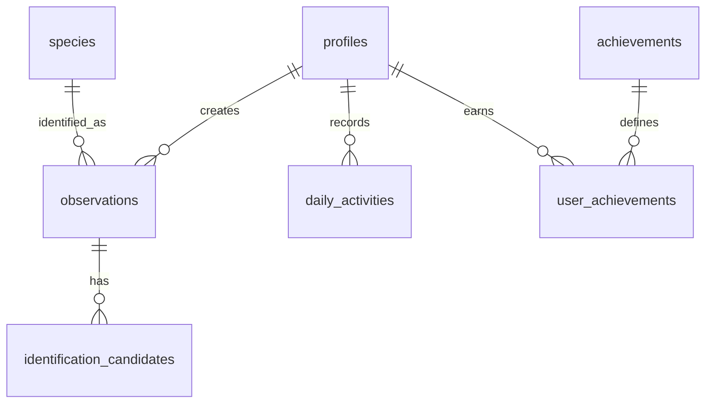

# PRODUCT REQUIREMENTS DOCUMENT (PRD)
# Animal Discovery

**Versi:** 1.0  
**Status:** Draft  
**Platform:** Android & iOS  
**Framework:** Flutter  
**Backend:** Supabase  
**Architecture:** Clean Architecture + Feature-First

---

## 1. Product Overview

### 1.1 Deskripsi Produk

Animal Discovery adalah aplikasi mobile berbasis AI yang membantu pengguna mengenali berbagai jenis hewan melalui foto.

Pengguna dapat mengambil foto atau mengunggah gambar hewan, kemudian sistem menggunakan AI untuk mengidentifikasi kemungkinan spesies berdasarkan gambar tersebut.

Setelah proses identifikasi, pengguna dapat melihat informasi detail mengenai hewan, menyimpan hasil penemuan ke koleksi pribadi, mencatat aktivitas eksplorasi, serta memperoleh achievement berdasarkan aktivitas mereka.

Animal Discovery dirancang untuk menjadi platform eksplorasi dan pembelajaran keanekaragaman hayati yang interaktif, informatif, dan mudah digunakan.

### 1.2 Problem Statement

Banyak orang menemukan hewan yang belum mereka kenal, tetapi mengalami kesulitan untuk mengetahui nama spesies dan informasi terkait hewan tersebut.

Beberapa permasalahan yang ingin diselesaikan:

- Pengguna kesulitan mengidentifikasi spesies hewan hanya berdasarkan penampilan.
- Informasi mengenai spesies tersebar di berbagai sumber.
- Tidak tersedia tempat terpusat untuk menyimpan hasil penemuan hewan.
- Aktivitas eksplorasi keanekaragaman hayati kurang memiliki sistem pencatatan dan motivasi.

### 1.3 Product Vision

Menjadi aplikasi eksplorasi keanekaragaman hayati yang memungkinkan siapa saja mengenali, mempelajari, dan mendokumentasikan berbagai spesies hewan dengan bantuan teknologi AI.

---

## 2. Product Goals

Tujuan utama pengembangan Animal Discovery:

1. Mempermudah identifikasi spesies hewan menggunakan teknologi AI.
2. Menyediakan informasi spesies yang informatif dan terstruktur.
3. Memungkinkan pengguna menyimpan dan mengelola hasil identifikasi.
4. Meningkatkan keterlibatan pengguna melalui sistem aktivitas dan achievement.
5. Membangun pengalaman belajar mengenai keanekaragaman hayati yang menyenangkan.

### 2.1 Success Metrics

| Metric | Indikator keberhasilan |
|---|---|
| Registration | Pengguna berhasil membuat akun |
| Identification | Pengguna berhasil menyelesaikan identifikasi |
| Identification Confirmation | Pengguna mengonfirmasi hasil identifikasi |
| Collection Usage | Pengguna menyimpan spesies ke koleksi |
| Retention | Pengguna kembali menggunakan aplikasi |
| Engagement | Pengguna menyelesaikan aktivitas dan achievement |

Target angka akan ditentukan setelah MVP diuji kepada pengguna.

---

## 3. Target Users

### 3.1 Primary Users

**Nature Enthusiasts**

Orang yang tertarik mempelajari dan mengenali berbagai spesies hewan.

**Students**

Pelajar yang ingin mempelajari keanekaragaman hayati melalui pengalaman interaktif.

**Casual Explorers**

Pengguna yang penasaran dengan hewan yang mereka temukan di lingkungan sekitar.

### 3.2 User Needs

Pengguna membutuhkan:

- Identifikasi hewan yang mudah dan cepat.
- Informasi spesies yang mudah dipahami.
- Riwayat hasil identifikasi.
- Koleksi spesies pribadi.
- Motivasi untuk terus mengeksplorasi spesies baru.

---

## 4. Core Features

### 4.1 Authentication

Pengguna dapat membuat akun dan masuk ke aplikasi.

**Requirements:**
- Register menggunakan email dan password.
- Login menggunakan email dan password.
- Logout.
- Menyimpan session pengguna.
- Mengelola profil pengguna.

**Technology:** Supabase Auth.

### 4.2 Animal Identification

<Badge>Core Feature</Badge>

Fitur utama untuk mengidentifikasi hewan melalui gambar.

**User Flow:**

1. Pengguna membuka halaman Discovery.
2. Pengguna mengambil foto atau memilih gambar dari galeri.
3. Aplikasi mengirim gambar untuk diproses.
4. AI menganalisis gambar.
5. Sistem menghasilkan kandidat spesies beserta tingkat keyakinan jika tersedia.
6. Pengguna melihat hasil identifikasi.
7. Pengguna dapat mengonfirmasi atau memilih kandidat lain.

**Requirements:**
- Camera integration.
- Image gallery picker.
- Image preview.
- AI-powered image identification.
- Multiple identification candidates.
- Confidence score jika disediakan model.
- Konfirmasi hasil identifikasi oleh pengguna.
- Menyimpan hasil identifikasi ke database.

**Technology:**
- Gemini Vision untuk analisis gambar.
- Supabase Edge Functions sebagai backend orchestration.
- iNaturalist dan GBIF untuk membantu memperoleh informasi taksonomi.

Catatan: Hasil AI merupakan rekomendasi, bukan kepastian ilmiah. Pengguna harus dapat mengetahui ketika hasil identifikasi tidak meyakinkan.

### 4.3 Species Details

Menampilkan informasi lengkap mengenai spesies yang berhasil diidentifikasi.

**Data yang ditampilkan:**
- Nama umum.
- Nama ilmiah.
- Kingdom.
- Phylum.
- Class.
- Order.
- Family.
- Genus.
- Species.
- Deskripsi.
- Gambar spesies.
- Informasi tambahan jika tersedia.

**Data Source:**
- iNaturalist.
- GBIF.

### 4.4 Personal Collection

Fitur untuk menyimpan spesies yang ditemukan pengguna.

**Requirements:**
- Menambahkan spesies ke koleksi.
- Menghapus spesies dari koleksi.
- Melihat seluruh koleksi.
- Membuka detail spesies dari koleksi.
- Melihat tanggal penemuan.
- Mencegah duplikasi spesies yang sama dalam koleksi jika sesuai aturan produk.

### 4.5 Daily Activity & Streak

Fitur untuk mencatat aktivitas eksplorasi pengguna.

**Requirements:**
- Mencatat aktivitas identifikasi.
- Menampilkan aktivitas harian.
- Menghitung streak berdasarkan aktivitas yang memenuhi syarat.
- Menampilkan jumlah hari aktif.
- Memperbarui streak berdasarkan zona waktu pengguna.

### 4.6 Achievement System

Sistem penghargaan untuk meningkatkan motivasi eksplorasi.

Contoh achievement:

| Achievement | Kondisi |
|---|---|
| First Discovery | Identifikasi pertama |
| Explorer | Menemukan 5 spesies |
| Wildlife Hunter | Menemukan 10 spesies |
| Consistent Explorer | Aktif selama 7 hari |
| Collector | Mengumpulkan 20 spesies |

**Requirements:**
- Daftar achievement.
- Status locked dan unlocked.
- Progress achievement.
- Pencatatan tanggal achievement diperoleh.
- Notifikasi ketika achievement terbuka.

### 4.7 Sharing

Pengguna dapat membagikan hasil penemuan spesies.

**Requirements:**
- Membuat share card.
- Menampilkan gambar spesies.
- Menampilkan nama spesies.
- Menampilkan informasi singkat.
- Membagikan melalui fitur share bawaan perangkat.

### 4.8 Statistics

Menampilkan statistik eksplorasi pengguna.

**Requirements:**
- Total spesies ditemukan.
- Total identifikasi.
- Jumlah hari aktif.
- Achievement yang diperoleh.
- Aktivitas eksplorasi.

### 4.9 Map (Future Feature)

Fitur untuk menampilkan lokasi penemuan spesies.

**Requirements:**
- Menyimpan koordinat penemuan jika pengguna memberikan izin.
- Menampilkan lokasi pada peta.
- Menampilkan daftar penemuan berdasarkan lokasi.

Fitur ini direncanakan untuk pengembangan setelah MVP.

### 4.10 Profile

Pengguna dapat mengelola informasi akun.

**Requirements:**
- Melihat profil.
- Mengubah nama pengguna.
- Mengubah foto profil.
- Melihat statistik eksplorasi.
- Logout.

---

## 5. Application Navigation

Struktur navigasi utama:

| Navigation | Description |
|---|---|
| Home | Dashboard aktivitas dan informasi |
| Discovery | Identifikasi hewan |
| Collection | Koleksi spesies pengguna |
| Achievements | Daftar pencapaian |
| Profile | Profil dan pengaturan |

Detail spesies, hasil identifikasi, dan halaman pendukung dapat diakses dari halaman utama tersebut.

---

## 6. User Flow

### 6.1 First-Time User Flow

1. Pengguna membuka aplikasi.
2. Aplikasi menampilkan onboarding.
3. Pengguna melakukan registrasi atau login.
4. Pengguna diarahkan ke Home.
5. Pengguna dapat memulai identifikasi pertama.

### 6.2 Identification Flow

1. Pengguna membuka Discovery.
2. Memilih kamera atau galeri.
3. Memilih gambar hewan.
4. Aplikasi menampilkan preview.
5. Pengguna memulai identifikasi.
6. Backend memproses gambar menggunakan AI.
7. Sistem menampilkan hasil dan kandidat spesies.
8. Pengguna memilih atau mengonfirmasi hasil.
9. Pengguna dapat membuka detail spesies.
10. Pengguna dapat menyimpan spesies ke Collection.

### 6.3 Collection Flow

1. Pengguna membuka Collection.
2. Sistem mengambil data koleksi pengguna.
3. Pengguna memilih salah satu spesies.
4. Aplikasi menampilkan Species Details.

---

## 7. Technical Requirements

### 7.1 Technology Stack

| Layer | Technology |
|---|---|
| Mobile Framework | Flutter |
| Programming Language | Dart |
| State Management | Riverpod |
| Navigation | GoRouter |
| Backend | Supabase |
| Authentication | Supabase Auth |
| Database | PostgreSQL |
| File Storage | Supabase Storage |
| Server Logic | Supabase Edge Functions |
| AI Identification | Gemini Vision |
| Taxonomy Data | iNaturalist & GBIF |

### 7.2 Architecture

Menggunakan Clean Architecture dengan pendekatan Feature-First.

Struktur pembagian layer:

**Presentation**
- Pages.
- Widgets.
- Providers.
- UI State.

**Domain**
- Entities.
- Repository Contracts.
- Use Cases.

**Data**
- Models.
- Data Sources.
- Repository Implementations.

### 7.3 Project Structure

```text
lib/
├── main.dart
├── app/
│   ├── app.dart
│   ├── router/
│   ├── theme/
│   └── providers/
│       └── supabase_provider.dart
│
├── core/
│   ├── constants/
│   ├── enums/
│   ├── errors/
│   ├── extensions/
│   ├── network/
│   ├── permissions/
│   ├── storage/
│   ├── utils/
│   └── widgets/
│
├── shared/
│   ├── models/
│   ├── providers/
│   └── widgets/
│
└── features/
    ├── auth/
    ├── home/
    ├── discovery/
    ├── animals/
    ├── collection/
    ├── streak/
    ├── achievements/
    ├── sharing/
    ├── statistics/
    ├── map/
    └── profile/
```

---

## 8. Database Requirements

Database menggunakan Supabase PostgreSQL.

### 8.1 Core Tables

| Table | Purpose |
|---|---|
| profiles | Data profil pengguna |
| species | Informasi spesies hewan |
| observations | Catatan penemuan hewan |
| identification_candidates | Kandidat hasil identifikasi AI |
| daily_activities | Aktivitas harian pengguna |
| achievements | Master data achievement |
| user_achievements | Achievement yang diperoleh pengguna |

### 8.2 Entity Relationships



### 8.3 Database Rules

- Setiap pengguna memiliki profil sendiri.
- Observasi terhubung dengan pengguna.
- Informasi spesies dapat digunakan bersama oleh seluruh pengguna.
- Kandidat identifikasi terhubung dengan observasi.
- Pengguna hanya dapat mengakses dan mengelola data pribadi sesuai kebijakan akses.
- Proses konfirmasi hasil dan pemberian achievement harus divalidasi oleh backend.
- Row Level Security (RLS) wajib diterapkan pada tabel yang terekspos ke client.

---

## 9. Security Requirements

1. Supabase Anon/Publishable Key hanya digunakan sesuai mekanisme keamanan Supabase.
2. Supabase Service Role Key tidak boleh disimpan di aplikasi Flutter.
3. Proses sensitif dilakukan melalui Edge Functions.
4. RLS diterapkan untuk melindungi data pengguna.
5. Validasi input dilakukan di client dan backend.
6. Upload gambar memiliki batas ukuran dan tipe file.
7. API key layanan AI disimpan di server, bukan di aplikasi mobile.
8. Izin kamera dan lokasi diminta sesuai kebutuhan fitur.

---

## 10. Non-Functional Requirements

### Performance
- UI harus tetap responsif ketika proses identifikasi berjalan.
- Proses AI harus menampilkan loading state.
- Gambar perlu dikompresi sebelum dikirim jika diperlukan.
- Data yang sering digunakan dapat menggunakan caching.

### Reliability
- Aplikasi menangani kegagalan koneksi internet.
- Aplikasi memberikan pesan error yang jelas.
- Proses penyimpanan tidak boleh menghasilkan data duplikat akibat retry yang tidak terkendali.

### Usability
- Navigasi mudah dipahami.
- Tampilan konsisten.
- Hasil identifikasi mudah dibaca.
- Pengguna dapat membatalkan proses upload atau identifikasi.

### Scalability
- Arsitektur memungkinkan penambahan fitur baru.
- Database dirancang untuk pertumbuhan jumlah pengguna dan spesies.
- Integrasi AI dan taxonomy API tidak bergantung langsung pada UI.

---

## 11. MVP Scope

MVP adalah versi pertama yang berfokus pada fungsi inti aplikasi.

### Included in MVP

- [ ] Authentication.
- [ ] Home dashboard.
- [ ] Camera dan gallery integration.
- [ ] AI animal identification.
- [ ] Identification candidates.
- [ ] User confirmation.
- [ ] Species details.
- [ ] Personal collection.
- [ ] Daily activity.
- [ ] Basic streak.
- [ ] Basic achievement.
- [ ] User profile.

### Post-MVP

- [ ] Share card.
- [ ] Advanced statistics.
- [ ] Map exploration.
- [ ] Social interaction.
- [ ] Community observations.
- [ ] Advanced gamification.

---

## 12. Acceptance Criteria

MVP dinyatakan siap diuji ketika:

1. Pengguna dapat melakukan registrasi dan login.
2. Session tetap tersedia setelah aplikasi dibuka kembali sesuai masa berlaku session.
3. Pengguna dapat mengambil atau memilih gambar.
4. Sistem dapat memproses gambar dan memberikan hasil identifikasi atau pesan kegagalan yang jelas.
5. Sistem dapat menampilkan kandidat spesies.
6. Pengguna dapat mengonfirmasi hasil identifikasi.
7. Detail spesies dapat ditampilkan.
8. Pengguna dapat menyimpan dan melihat koleksi.
9. Aktivitas pengguna tercatat dengan benar.
10. Achievement diberikan berdasarkan kondisi yang telah ditentukan.
11. Data antar pengguna terlindungi oleh RLS.
12. Aplikasi dapat menangani kondisi tanpa koneksi internet dengan baik.

---

## 13. Development Roadmap

| Phase | Focus | Deliverables |
|---|---|---|
| Phase 1 | Foundation | Flutter setup, architecture, routing, theme |
| Phase 2 | Backend | Supabase setup, schema, RLS, storage |
| Phase 3 | Authentication | Register, login, session management |
| Phase 4 | Discovery | Image picker, AI identification |
| Phase 5 | Species | Taxonomy integration, species details |
| Phase 6 | Collection | Save, view, delete collection |
| Phase 7 | Gamification | Daily activity, streak, achievements |
| Phase 8 | Testing | Unit, widget, integration testing |
| Phase 9 | Release | MVP testing and deployment |

---

## 14. Risks & Mitigation

| Risk | Mitigation |
|---|---|
| AI salah mengidentifikasi hewan | Menampilkan beberapa kandidat dan menyediakan konfirmasi pengguna |
| Gambar tidak jelas | Memberikan panduan pengambilan gambar dan pesan error |
| API eksternal mengalami gangguan | Menangani timeout, retry terbatas, dan caching |
| Biaya AI meningkat | Membatasi ukuran gambar dan penggunaan API |
| Data pengguna tidak aman | Menerapkan RLS dan backend validation |
| Informasi spesies tidak tersedia | Menampilkan informasi yang tersedia tanpa mengarang data |

---

## 15. Product Principles

Animal Discovery dikembangkan berdasarkan prinsip berikut:

1. **Accuracy First:** Mengutamakan kualitas informasi dan transparansi hasil identifikasi.
2. **Education First:** Setiap fitur harus memberikan nilai edukasi.
3. **User Ownership:** Pengguna memiliki kendali atas koleksi dan observasi pribadinya.
4. **Simple Experience:** Proses identifikasi harus sederhana.
5. **Responsible Exploration:** Aplikasi tidak mendorong pengguna mengganggu, menangkap, atau membahayakan satwa liar.

---

## 16. Future Vision

Dalam jangka panjang, Animal Discovery dapat berkembang menjadi platform citizen science yang memungkinkan pengguna berkontribusi terhadap dokumentasi keanekaragaman hayati.

Pengembangan selanjutnya dapat mencakup:
- Community-based species identification.
- Regional biodiversity exploration.
- Observation contribution.
- Species distribution visualization.
- Educational challenges.
- Integration dengan lebih banyak sumber data biodiversitas.

**End of Document**
